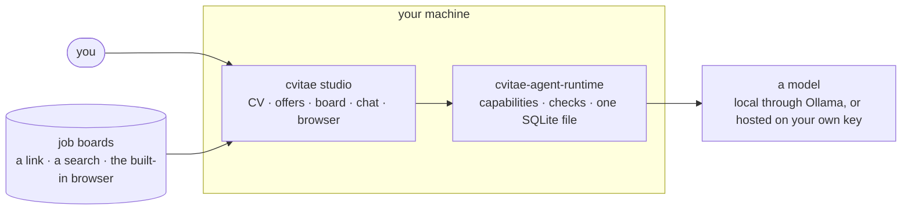

# cvitae

**Tailoring a job application to a posting, without inventing anything.**

A modern job search is a volume game, and every way of playing it is bad. The
employer screens with a parser before a person reads anything, so a CV that is
handsome and unparseable is a CV nobody saw. The candidate sends the same
document to two hundred postings, because rewriting it each time costs half an
hour and a search runs on evenings. And the obvious automation — hand a model
the CV and the posting, take back a new CV — fails in the way that is hardest to
catch: it invents. A framework nobody used, a team nobody led, two years rounded
up to four, written in the applicant's own voice and indistinguishable from the
true sentences around it.

These repositories are the fourth option. A model reads the posting, proposes an
arrangement of facts **that already exist in your CV**, and a person approves
every one of them before anything leaves the machine. The model selects, orders
and rewords. It does not author facts, and the code is arranged so that it
cannot.

## The repositories

| | What it is | What it holds |
| --- | --- | --- |
| **[cvitae-studio](https://github.com/cvitae-org/cvitae-studio)** (private for now) | the macOS desktop app: a CV kept in Polish and English, offers collected from job boards and queried with SQL, a board of the ones being pursued, a chat about the CV, and a built-in browser where an application form is filled in and a person presses Send | your provider keys, in the macOS login Keychain |
| **[cvitae-agent-runtime](https://github.com/cvitae-org/cvitae-agent-runtime)** | the AI layer, a separate process the app starts and talks to: the capabilities, their prompts and the checks on what comes back, the providers, and a record of what each answer was given | everything you keep, in one SQLite file under `~/.cvitae` |
| **[cvitae-mail](https://github.com/cvitae-org/cvitae-mail)** | a mailbox companion, alone in a process: it writes drafts, and no route above it can make it send. The desktop app does not use it | one Gmail refresh token, and nothing else |
| **[cvitae](https://github.com/cvitae-org/cvitae)** (archived) | the first version: a web app that kept everything in your browser | — |

Offers arrive the way you already have them — a link, a search across the
boards you pick, or a page opened in the app's own browser. Each one is read
once into structured facts, and the original text is kept alongside them, so a
row still works after the posting has been taken down.

## How the pieces fit

The app draws and the runtime decides. The app supplies what only a desktop app
can — the window, the Keychain, a browser — and every call to a model goes
through the runtime, where what the model is sent and what comes back are both
checked.

## Three rules the whole thing follows

**Generate what is not there, parse what is.** Most of this work is copying
values that already exist in a document into fields, which a small fast model
does in seconds and a regex sometimes does better. One extraction step uses no
model at all: asked to quote a summary paragraph, small models returned the
*instruction* four times in five, while a parser is correct every time and
cannot hallucinate. One model call writes the covering letter, because that is
the only text genuinely absent from the input.

**The model sees only what it is given, and so can you.** It never receives a
database handle, a file path or a URL to fetch. Job postings are text strangers
wrote, and that text goes into model context, so a model talked into something
by a posting can return something unhelpful and cannot reach anything. Every
answer in the chat comes with the runtime's record of what the model was given.
A person can leave a piece of the CV out of a conversation, choose which pieces a
message is made from, and see a message before it is sent. When saved offers are
compared, the answer cites the block behind each claim by number, and a number
that points at nothing is listed apart rather than passed on.

**Suggestions, never sends.** Where an application goes is decided without a
model, by weighing facts a web page cannot assert about itself — is the address
on the employer's own domain, did two independent sources name it — because
postings that exist to harvest CVs are a real business and a CV is a complete
identity package. When the app fills in an application form, which controls it
may press is decided by what they are, not by what they say, and it stops before
the last step. A person presses Send.

## Where the data lives

- **On your machine.** Everything you keep — the CV, offers, the board,
  conversations — is one SQLite file, readable by your account only, copied aside
  before every upgrade and refused by a build older than the one that wrote it.
  Provider keys live in the macOS login Keychain. Model calls are logged as
  metadata only — sizes, counts, timings, a code — never prompts, never
  responses.
- **Nowhere else, unless you choose a hosted model.** Run local models through
  Ollama and no model call leaves the machine. Use a hosted provider and the bill
  is on your own account, with your own key. Even then the name, email, phone
  number and links in your CV are masked before anything is sent and put back
  into the answer; the CV's search index is built locally unless you pick a
  hosted embedder, which is masked the same way. Importing a CV is the one call
  that needs your details as they are, so the app asks before a hosted model
  reads it.

## Start here

The [runtime](https://github.com/cvitae-org/cvitae-agent-runtime) is the part
that is public, and its README is the place to read how the AI side is wired:
why the boundaries are shaped as they are, what each capability checks before it
returns, and what reaches a model. Its `docs/measurements` keep the runs behind
the decisions, with every answer.

## Status

Personal-scale software, built in the open where it can be, and verified
against real data rather than assumed to work. CV extraction is checked against
a real CV, and the chat was measured on a local model: answering from pieces of the CV attached to a
message got all 48 questions right, in English and Polish, as the model's own
search tools did; comparing five saved offers put the best fit first in 32 runs
of 32, and none of its 491 citations pointed at nothing. No hosted model has been
measured yet. The READMEs are unusually frank about what is measured, what is
still unverified and what a given guarantee does *not* cover. That is deliberate
— a tool that decides what a model may claim about your career should be honest
about what it claims for itself.
