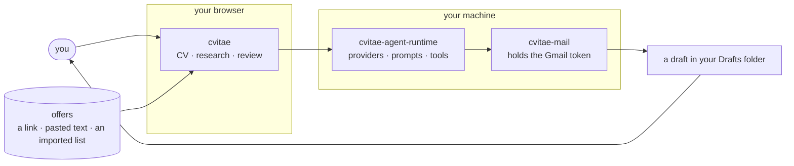

# cvitae

**Tailoring a job application to a posting, in minutes, without inventing
anything.**

**[Open the staging build →](https://cvitae-app.netlify.app/)** — the
application as it currently stands. Whatever you type there stays in your own
browser.

A modern job search is a volume game, and every way of playing it is bad. The
employer screens with a parser before a person reads anything, so a CV that is
handsome and unparseable is a CV nobody saw. The candidate sends the same
document to two hundred postings, because rewriting it each time costs half an
hour and a search runs on evenings. And the obvious automation — hand a model
the CV and the posting, take back a new CV — fails in the way that is hardest to
catch: it invents. A framework nobody used, a team nobody led, two years rounded
up to four, written in the applicant's own voice and indistinguishable from the
true sentences around it.

These repositories are the fourth option. A model reads the posting, proposes an
arrangement of facts **that already exist in your CV**, and a person approves
every one of them before a PDF exists. The model selects, orders and rewords. It
does not author facts, and the code is arranged so that it cannot.

## The repositories

| | What it is | What it holds |
| --- | --- | --- |
| **[cvitae](https://github.com/cvitae-org/cvitae)** | the application — an editable EN/PL CV, vacancy research, and evidence review before anything is sent | your CV, your researched offers and your submissions, in your own browser |
| **[cvitae-agent-runtime](https://github.com/cvitae-org/cvitae-agent-runtime)** | the AI layer — providers, prompts and tool definitions behind a single `run()`, so nothing above it holds a key or picks a model | the provider keys, the prompts, and a local index under `~/.cvitae` |
| **[cvitae-mail](https://github.com/cvitae-org/cvitae-mail)** | the mailbox, alone in a process — it writes drafts, and no route above it can make it send | one Gmail refresh token, and nothing else |

Offers arrive the way you already have them — a link, text pasted out of your
own browser, or a list imported in one go. Each one is read once into structured
facts and requirements quoted in the posting's own words, and the original text
is kept alongside them, so a row still works after the posting has been taken
down.

Everything except the application itself is optional and written to be absent.
With no runtime running, cvitae still edits and exports a CV. With no mailbox
connected, the app says so and the PDF simply downloads.

## How the pieces fit

The split is not architectural taste. It is about what one mistake costs. A
provider key that leaks is a bill; a mailbox token that leaks is read access to
everything you have ever been sent plus the ability to write as you. Keeping
them in different processes means a single failure is one of those things and
never both — and the process holding the mailbox holds neither the CV nor the
model keys.

## Three rules the whole thing follows

**Generate what is not there, parse what is.** Most of this work is copying
values that already exist in a document into fields, which a small fast model
does in seconds and a regex sometimes does better. One extraction step uses no
model at all: asked to quote a summary paragraph, small models returned the
*instruction* four times in five, while a parser is correct every time and
cannot hallucinate. One model call writes the covering letter, because that is
the only text genuinely absent from the input.

**The model acts through tools, or it does not act.** Where a model can call
tools at all, it never receives a database handle, a file path or a URL to
fetch. Job postings are text strangers wrote — anyone can put prose on a board —
and that text goes into model context, so a model talked into something by a
posting can return something unhelpful and cannot reach anything. Drafting an email is deliberately not a tool: untrusted
input, a private CV and an outbound channel in one tool set is the whole
exfiltration triangle, and the third side is simply never built.

**Suggestions, never sends.** Where an application goes is decided without a
model, by weighing facts a web page cannot assert about itself — is the address
on the employer's own domain, did two independent sources name it — because
postings that exist to harvest CVs are a real business and a CV is a complete
identity package. The result is ranked with its evidence attached and it warns
rather than blocks. Applications leave as drafts. A person presses Send.

## Where the data lives

- **In your browser.** No account, no login, no server-side profile, no
  database. Which also means no operator-side copy to breach, to subpoena or to
  sell — and no restore, since clearing site data is deletion.
- **On your machine**, if you run the runtime: one plain `cv.json` you can read
  and correct by hand, plus a derived index that any `POST /reindex` rebuilds.
  AI calls are logged as metadata only — model, latency, tokens, status, content
  *hashes* — never prompts, never responses. `rm -rf ~/.cvitae` is the whole
  deletion story.
- **Nowhere else.** Model calls carry a narrowed payload: contact details, CV
  source metadata and the vacancy's URL never reach the model. Run local models
  through Ollama and no model call leaves the machine at all; use a hosted
  provider and the bill is on your own account, with your own key, kept nowhere.

## Start here

[Staging is here](https://cvitae-app.netlify.app/) if you would rather look than
read. Otherwise start with [cvitae](https://github.com/cvitae-org/cvitae) — it
is the thing you use, and its README explains the tailoring model, the ATS-safe PDF pipeline and
what is protected from the model. The
[runtime](https://github.com/cvitae-org/cvitae-agent-runtime) is worth reading
next if you care how the AI side is wired, and it carries the measurements
behind most of the decisions above.

## Status

Personal-scale software, built in the open, verified against real data rather
than assumed to work: CV extraction is checked against a real CV, drafting end
to end on a local model, PDFs re-parsed from their own bytes before download,
and the mail path exercised against a live mailbox. The READMEs are unusually
frank about what is measured, what is still unverified and what a given
guarantee does *not* cover. That is deliberate — a tool that decides what a
model may claim about your career should be honest about what it claims for
itself.
